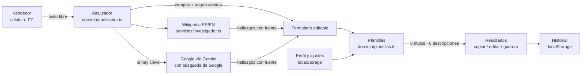

# AutoPublicador — contexto completo del proyecto

> **Para quien llegue nuevo (persona o IA):** este archivo explica qué es el proyecto, por qué existe, cómo
> funciona de inicio a fin, qué decisiones se tomaron y qué se ha hecho (bitácora al final). Léelo antes de
> tocar el código. Se actualiza en cada cambio importante.

- **Sitio publicado:** https://zeuspyec.github.io/AutoPublicador/
- **Repositorio:** https://github.com/zeuspyEC/AutoPublicador
- **Carpeta local:** `C:\Users\Erick\Documents\AutoPublicador`

---

## 1. Qué problema resuelve

Vendedores de autos usados en Quito publican cada vehículo en **Facebook Marketplace**. Redactar un buen título
y una buena descripción para cada carro toma tiempo y las publicaciones que mejor funcionan siguen un patrón
(ver §4). AutoPublicador hace que el vendedor **escriba unos pocos datos del carro** y obtenga al instante
**varias opciones de título y de descripción** listas para copiar y pegar, con datos técnicos **reales**
(investigados y con fuente, nunca inventados) y con su contacto en un formato que Facebook no oculta.

Fuera de alcance por ahora: fotos (no hay almacenamiento), respuestas a clientes, CRM y agenda de citas
(ver §10, hoja de ruta).

## 2. Requisitos

### Funcionales
| Id | Requisito | Estado |
|---|---|---|
| RF1 | Al primer uso pedir **nombre** y **celular** del vendedor (y opcionalmente horario); usarlos en las plantillas. Varios vendedores pueden usar la app, cada uno en su dispositivo. | ✅ |
| RF2 | Entrada de **texto libre** con la información básica del vehículo; un botón genera todo. | ✅ |
| RF3 | **Extraer** del texto: marca, modelo, versión, año (también «del 98», «año 92»), motor, transmisión, combustible, kilometraje, precio y precio anterior, matrícula y cero multas, procedencia, puertas, tracción, color, equipamiento, estado, negociable, recibe cambio, a toda prueba. | ✅ |
| RF4 | **Investigar** datos reales del modelo en fuentes públicas y **autocompletar** los campos vacíos cuando el dato es inequívoco; mostrar cada dato con su **fuente** y permitir aplicarlo con un toque. | ✅ Wikipedia · ✅ Google (opcional, con clave) |
| RF5 | Detectar inconsistencias (año fuera del período de producción, motor que no existió para el modelo) y avisar. | ✅ |
| RF6 | Generar **varias variantes de título** y **de descripción** basadas en las publicaciones que funcionaron. | ✅ 8 títulos + 5 condicionales · 12 descripciones |
| RF7 | El **teléfono nunca aparece limpio** (Facebook lo cambia por asteriscos): se separa con guiones, puntos, diagonales, mixto o emojis. | ✅ |
| RF8 | Ubicación general fija: **Sector El Inca (Norte de Quito)**, sin dirección exacta (para que el cliente escriba). Editable en Ajustes. | ✅ |
| RF9 | Todo **editable**: campos del vehículo, textos generados, beneficios ofrecidos. | ✅ |
| RF10 | **Copiar** con un toque (título, descripción, precio). | ✅ |
| RF11 | **Historial** de publicaciones guardadas para reutilizarlas. | ✅ |
| RF12 | **Consulta por placa** (SRI): marca, modelo (con versión, motor, puertas y transmisión del modelo registrado), año, cilindraje, color, país, clase, matrícula y valores pendientes. Sin datos del propietario. Si el navegador no puede consultar el SRI, respaldo: abrir la consulta y **pegar** el resultado (JSON o texto). | ✅ |
| RF13 | **Pegar lo copiado de Google** (sin API): se extraen motor, transmisión, tracción, potencia, torque, consumo, velocidades y pasajeros. | ✅ |
| RF14 | **Corrección de errores de tipeo** del modelo («Alegro» → «Allegro») y nombres comerciales de Ecuador → artículo internacional (Allegro → Mazda 323). | ✅ |
| RF15 | **Diagnóstico de la clave de Google** en Ajustes (modelos permitidos, prueba con y sin búsqueda, motivo exacto de cada error). | ✅ |
| RF17 | **Historial de placas consultadas** (placa, resumen, datos y avisos del SRI) para crear otra publicación sin volver a consultar. | ✅ |
| RF18 | **Motos**: marcas frecuentes, cilindraje en cc, clase «Moto» y redacción adecuada. | ✅ |
| RF19 | **La placa manda**: con placa, los datos de identidad del SRI (marca, modelo, año, motor, color, procedencia, matrícula, clase) reemplazan lo escrito en el texto; se muestran las diferencias y se puede volver al texto. Wikipedia y Google investigan el modelo que registra el SRI. | ✅ |
| RF20 | **Servidor de placas propio** (`servidor/`, Cloudflare Worker) para consulta automática desde cualquier navegador; solo datos del vehículo. | ✅ publicado: https://autopublicador-placas.erick-costa.workers.dev (cuenta Cloudflare propia del usuario, proyecto independiente de AutoLab) |
| RF16 | **Comentarios y respuestas rápidas** para la publicación (disponible, cita, precio, cambio, papeles, horario, subir). | ✅ |

### No funcionales
- Uso principal desde el **celular** (diseño móvil, botones ≥ 44 px, modo oscuro).
- **Sin servidor propio** ni costos: sitio estático en GitHub Pages; datos en el navegador (localStorage).
- **Nada inventado:** las plantillas omiten las líneas sin datos; lo investigado se marca con su fuente.
- Control de versiones con commits por etapas y despliegue automático probado (CI).

## 3. Arquitectura



| Capa | Archivos | Responsabilidad |
|---|---|---|
| Dominio (puro, probado) | `src/dominio/tipos.ts`, `catalogo.ts`, `analizador.ts`, `telefono.ts`, `plantillas.ts` | Entender el texto, formatear el teléfono, redactar las variantes |
| Servicios | `src/servicios/wikitexto.ts` (lectura de fichas), `investigador.ts` (Wikipedia + Google), `almacen.ts` (localStorage, copiar) | Datos externos y persistencia |
| Interfaz (React) | `src/App.tsx`, `src/componentes/*.tsx`, `src/index.css` | Flujo en 4 pasos, ajustes, historial |
| Servidor | `servidor/src/index.js`, `servidor/wrangler.toml` | Consulta el SRI para la app (CORS solo para la app, sin datos personales, caché 6 h) |
| Despliegue | `.github/workflows/desplegar.yml`, `vite.config.ts` (`base: /AutoPublicador/`) | Pruebas → build → GitHub Pages |

**Tecnologías:** React 19 + TypeScript + Vite 8, Vitest para pruebas, GitHub Actions + GitHub Pages.
Sin dependencias de ejecución aparte de React.

## 4. Patrón de las publicaciones que funcionan (base de las plantillas)

Se analizaron 5 publicaciones reales vendidas (capturas en `referencias/capturas/`, **no se suben al
repositorio** porque contienen nombre, teléfono y placa de terceros). Patrón común:

**Título:** gancho en mayúsculas («VENDO//CAMBIO», «VENDO DE OPORTUNIDAD», «🔥») + MARCA MODELO VERSIÓN +
motor («1.6L») + año + papeles («AL DÍA 2025», «PAPELES AL DÍA») + argumento («A TODA PRUEBA», «FULL EQUIPO /
TECHO + PANTALLA») + emojis 🔥💥✅💯🚗.

**Descripción (bloques):**
1. Gancho: «¡Se vende o se cambia!», «¡EL MEJOR PRECIO LO CONSIGUES AQUÍ!», «TODOS LOS PRECIOS CON DESCUENTO».
2. 💎 Detalles con ✅: Marca/Modelo, Año (Procedencia), Matrícula (Cero multas), Equipamiento, Mecánica.
3. 🤝 Beneficios con ✅: negociable en el patio, recibimos auto o moto como parte de pago, garantía, entrega
   inmediata, tarjetas y efectivo, trae a tu mecánico, escritura directa en notaría.
4. Cierre: 📍 ubicación general (Sector El Inca, Norte de Quito), ⏰ horario, 👨‍💼 nombre «Vendedor Autorizado
   💯», 📲 teléfono, «pide tu cita a nombre de…».

**Plantillas implementadas** (`plantillas.ts`): títulos `gancho-cambio`, `full-equipo`, `oportunidad`,
`explosion`, `directo`, `recibo-auto`, `traspaso`, `equipado`; descripciones `completa`, `contacto-primero`,
`descuento`, `corta`, `ficha` (nueva, técnica) y `conversacional` (nueva, cercana).

## 5. Flujo de uso (inicio a fin)

```mermaid
sequenceDiagram
  actor V as Vendedor
  participant App
  participant Wiki as Wikipedia
  participant Ggl as Google (Gemini)
  V->>App: Primer uso: nombre, celular, estilo del número, horario
  V->>App: Texto: «Peugeot 206 XT 1.6 2008 techo pantalla $4990…»
  App->>App: Analiza el texto → campos (origen «texto»)
  par Investigación en paralelo
    App->>Wiki: Ficha del modelo (ES e EN)
    Wiki-->>App: Carrocería, tracción, transmisión, motores, período…
  and
    App->>Ggl: Ficha de esa versión y año (solo si hay clave)
    Ggl-->>App: JSON + páginas consultadas
  end
  App->>App: Autocompleta campos vacíos con dato único; avisa inconsistencias
  App-->>V: 8 títulos + 6 descripciones (teléfono separado)
  V->>App: Corrige campos / aplica datos / edita texto
  V->>App: Copiar título, descripción y precio → pega en Marketplace
  V->>App: Guardar en historial
```

## 6. Reglas importantes

- **Teléfono:** se normaliza (+593 → 09…) y se valida (10 dígitos, empieza con 09). Estilos: `0987--654--321`,
  `0987.654.321`, `09/87/65/43/21`, `09-87.654/321`, emojis. La interfaz avisa si un texto editado a mano deja
  7+ dígitos seguidos. Prueba: «ningún estilo deja el número limpio».
- **Nada inventado:** las plantillas solo escriben líneas con datos presentes. La investigación solo
  autocompleta un campo **vacío** cuando hay **una sola opción** (p. ej., tracción delantera); si hay varias
  (manual/automática), decide el vendedor con un toque. Cada dato lleva su fuente y un enlace.
- **Origen de cada campo** visible: «de tu texto», «Wikipedia», «Google», «editado».
- **Ubicación:** solo la general (Sector El Inca, Norte de Quito).
- **Catálogo:** marcas/modelos frecuentes en Ecuador; si solo se escribe el modelo se deduce la marca más común
  («Vitara» → Chevrolet). Modelos que son palabras comunes («uno», «premio», «río») solo se aceptan con la marca.

## 7. Investigación de datos reales

| Fuente | Qué aporta | Costo / requisitos |
|---|---|---|
| Wikipedia (es) | Fabricante, período de producción por país, tipo, carrocerías, tracción, transmisiones, peso, largo, resumen | Gratis, sin clave. Cabecera `Api-User-Agent` (Wikipedia responde 429 sin identificación) |
| Wikipedia (en) | Lista de motores (cilindradas) y combustible (gasolina/diésel) | Igual |
| SRI por placa (`BaseVehiculo/obtenerPorNumeroPlacaOPorNumeroCampvOPorNumeroCpn` + `ConsultaRubros/obtenerPorCodigoVehiculo`, los mismos de ECPlacas) | Datos oficiales del vehículo y su matrícula | Gratis. Si el navegador no puede consultarlo (CORS o servicio caído), el vendedor abre el enlace de datos y pega el resultado |
| Google vía Gemini (modelo elegido de la lista real de la clave; herramienta `google_search`) | Datos de la versión y año exactos en Ecuador con las páginas consultadas. Si el plan no permite la búsqueda (error 429, cuota 0 en proyectos gratuitos), usa el modelo **sin búsqueda** y lo marca «verificar» | Clave de Google AI Studio en Ajustes (solo en el navegador). Botón «Probar clave» |
| Texto copiado de Google | Lo que el vendedor copia de la búsqueda (sin API ni clave) | Gratis |

**Fuentes descartadas:** el servicio de la ANT en axiscloud responde «ALLOW_DOMAIN NO AUTORIZADO» a otros sitios; saltarse ese bloqueo sería suplantar a otro sitio, por eso no se usa. Leer los resultados de Google directamente desde la app no es posible (Google y el navegador lo bloquean); la alternativa es «pegar lo copiado». Datos del propietario: nunca se usan.

La lectura de fichas (`wikitexto.ts`) respeta el anidamiento de `{{…}}` y `[[…]]`, resuelve enlaces antes que
plantillas, convierte `{{ubl|…}}`, `{{convert|…}}`/`{{convertir|…}}` y `&nbsp;` (casos reales que fallaban).

## 8. Pruebas

- `npm test` — 90 pruebas (incluye 11 del servidor de placas) · `npm run test:integracion` — 6 con Wikipedia real unitarias (analizador con los casos de las publicaciones reales, teléfono, plantillas,
  fichas de Wikipedia con texto real, formato de respuesta de Gemini).
- `npm run test:integracion` — 3 pruebas contra Wikipedia real (Peugeot 206, año fuera de producción, Chevrolet
  Vitara → Suzuki Vitara).
- Prueba de punta a punta en Chrome a 390 px (celular): perfil con validación, generar, autocompletado desde
  Wikipedia, aplicar un dato, cambiar de plantilla, copiar al portapapeles, historial, recarga con persistencia,
  sin desbordamiento horizontal, sin errores de consola.
- CI: cada push ejecuta pruebas y build; si fallan, no se publica.

## 9. Cómo trabajar en el proyecto

```bash
npm install
npm run dev            # http://localhost:5173/AutoPublicador/
npm test               # pruebas unitarias
npm run test:integracion
npm run build          # dist/
git push               # despliega solo (GitHub Actions → Pages)
```

Normas del autor: commits por etapas con mensajes en español, sin atribución de IA; no subir capturas con datos
de terceros, `.env` ni claves; mantener este archivo al día (sección 11).

## 10. Hoja de ruta (propuesta)

1. **Clave de Google sin pedirla a cada vendedor:** mover la consulta a Gemini a Firebase (AI Logic o una
   Cloud Function) del proyecto, con App Check, para que todos tengan búsqueda en Google sin configurar nada.
2. **Cuentas y sincronización (Firebase Auth + Firestore):** historial en la nube, varios dispositivos.
3. **CRM:** clientes interesados por publicación, estados (nuevo, contactado, cita, vendido), **agenda de
   citas** y recordatorios; entrada en texto libre que el sistema organiza solo («mañana 10am viene Juan a ver
   el Vitara» → cita).
4. **Respuestas rápidas** a mensajes de Marketplace con los datos de cada vehículo.
5. **Precio sugerido** comparando publicaciones similares.
6. Instalación como app (PWA con funcionamiento sin conexión).

## 11. Bitácora

| Fecha | Cambio |
|---|---|
| 2026-11-23 | Inicio del proyecto. Análisis de 5 publicaciones reales y definición de requisitos. |
| 2026-11-23 | Núcleo: analizador de texto libre, teléfono a prueba de Facebook, 8 títulos y 6 descripciones (15 pruebas). |
| 2026-11-23 | Investigación con fuente: Wikipedia ES/EN (lectura robusta de fichas) y Google vía Gemini. Se corrigieron: kilometraje que absorbía el «4» de «4x4», año confundido con el modelo «Peugeot 2008», palabras comunes tomadas como modelos, `&nbsp;` en motores, error 429 de Wikipedia sin `Api-User-Agent`. |
| 2026-11-23 | Interfaz móvil en 4 pasos, ajustes (perfil, ubicación, beneficios, clave de Google), historial. Prueba E2E en Chrome. Mejoras de redacción (versión «XT», «pantalla Android», horario, motor sin repetir). |
| 2026-11-23 | Despliegue automático en GitHub Pages con pruebas previas. Verificado en el sitio publicado (Chrome a 390 px). |
| 2026-11-23 | v0.6.0 — Todo lo aprovechable de PLACAS_EC: además de BaseVehiculo, ConsultaRubros, consultaPagos y plan excepcional, ahora ConsultaComponente (desglose: recargos e intereses por atraso) y obtenerDetallesPago (años de matrícula pagados). Descartado: ANT/axiscloud (responde «ALLOW_DOMAIN NO AUTORIZADO»; no se falsifica el origen) y las API de propietario (datos personales, nunca se usan). Verificado con 11 placas reales (autos, van, motos, placas antiguas, una inexistente). Con datos reales se corrigió: N200 se «corregía» a N300; M/T no se reconocía; marcas no catalogadas perdían el modelo (TK 150-7); rango completo de años adeudados (2017–2026); observación del SRI; transferencia de dominio pendiente con sus años. Coherencia: si la placa es de otro modelo, se quitan del texto versión/motor/puertas/carrocería. Pruebas E2E reales desde KitInformes/temporal (carpeta con excepción del antivirus). 90 pruebas + 6 de integración. |
| 2026-11-23 | v0.5.0 — Servidor de placas publicado en Cloudflare (proyecto propio `autopublicador-placas`, sin facturación) y fijado como predeterminado: consulta automática real desde cualquier navegador. Verificado con datos reales del SRI: YAA0208 (Chevytaxi 2010), MCY0327 (Corsa 2002), PJM343→PJM0343 y PJH665→PJH0665 (Suzuki Forsa 1992/1989, placas antiguas con 0 como en PLACAS_EC), moto JQ094F (Factory Bike F-370 2022). Hallazgos con la respuesta real: el SRI devuelve color, cilindraje y clase en null (no se inventan); el 1 % de transferencia de dominio es costo de traspaso, no deuda; historial de pagos (consultaPagos) → último pago de matrícula; moto por formato de placa; motor desde el modelo registrado («CORSA 5P A/C 1.4L»). Wikipedia: título exacto preferido y descarte de artículos de otra época (Forsa 1989 ≠ Cultus Crescent 1995-2007); Suzuki Forsa → Suzuki Cultus. 82 pruebas + 6 de integración con Wikipedia real. |
| 2026-11-23 | v0.4.0 — Prueba real del usuario (placa YAA0208): el SRI responde al navegador pero bloquea la lectura desde otra página (CORS); la consulta manual funcionó. Se creó el servidor de placas (`servidor/`, probado con el runtime real de Cloudflare en local); la app usa servidor → directo → manual. Se corrigió la incoherencia texto/placa (el texto decía Corsa 2002 y la placa es un Chevytaxi 2010): ahora manda el SRI, con aviso de diferencias. Chevytaxi → Chevrolet Aveo (Wikipedia). Lectura tolerante de campos del SRI; servicio no particular, cantón y revisión. 73 pruebas. |
| 2026-11-23 | v0.3.0 — Historial de placas; «Pegar del portapapeles»; diagnóstico del fallo del SRI (con una petición «no-cors» se distingue política del navegador vs. red); motos. Diagnóstico de red: el SRI está en línea (responde 200 desde Canadá, Alemania e Indonesia) pero filtra redes y regiones: no responde a la red del PC de desarrollo (Telealfacom, Ecuador) ni a GitHub Actions (EE. UU.). La lectura automática desde el navegador solo se puede confirmar en el celular del usuario; la consulta manual funciona siempre. 58 pruebas + 4 de integración; E2E con la placa real MCY0327 (diagnóstico correcto). |
| 2026-11-23 | v0.2.0 — Placa (SRI) con respaldo «pegar»; Google: descubre modelos, explica el 429 real del usuario (cuota agotada con búsqueda) y usa respaldo sin búsqueda marcado; diagnóstico de la clave; Wikipedia con nombres de Ecuador (Allegro → Mazda 323) y corrección de tipeo; abreviaturas TM/TA/AC; 12 descripciones, títulos condicionales y comentarios. 51 pruebas + 4 contra Wikipedia real; prueba E2E con SRI y Gemini simulados en su formato real. El SRI no responde desde la red de desarrollo: probar la consulta automática desde el celular. |
| 2026-11-23 | v0.1.1 — Prueba en el sitio publicado con otro vehículo: precio escrito sin símbolo («… cero multas 4990») no se detectaba; títulos largos quedaban cortados en su cuadro. Ambos corregidos (29 pruebas). |
